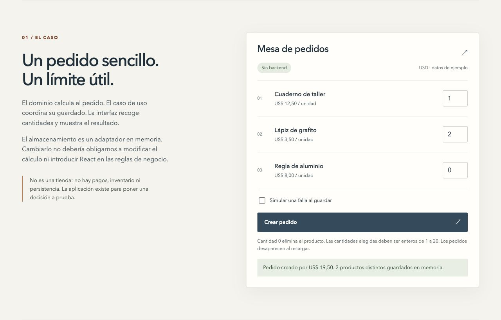
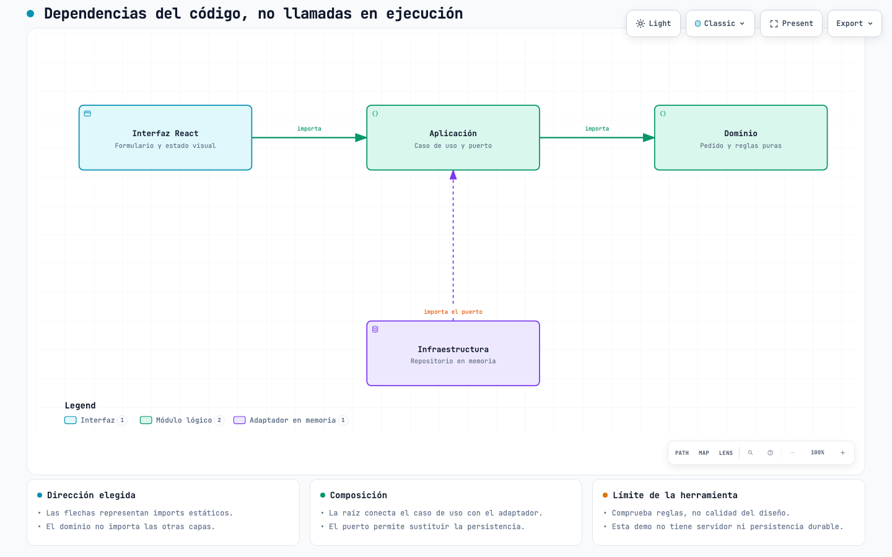

# Dependency Boundaries Lab

Una aplicación de pedidos para comprobar una decisión de arquitectura: **el dominio no depende de la interfaz**.

[**Abrir demo**](https://pabloc43.github.io/lab-dependency-boundaries/) · [CI](https://github.com/Pabloc43/lab-dependency-boundaries/actions) · [Guía técnica](docs/technical-guide.md)



Pedidos en memoria, una falla de guardado simulada y límites verificables. Sin pagos ni servicios externos.

## Un límite, tres casos

| Caso                 | Qué comprueba dependency-cruiser              | Salida esperada           |
| -------------------- | --------------------------------------------- | ------------------------- |
| Aplicación           | Respeta las fronteras elegidas                | `0`                       |
| Import incorrecto    | El dominio importa una notificación de UI     | `1` · `no-domain-outward` |
| Dependencia circular | `a.ts` importa `b.ts` y `b.ts` importa `a.ts` | `1` · `no-circular`       |

Los errores son fixtures aislados. `pnpm architecture` pasa cuando coinciden los tres resultados esperados.

## Ejecutar en local

Requiere **Node.js 24.x** y **pnpm 10.34.9**, fijados en [la configuración del proyecto](package.json).

```sh
git clone https://github.com/Pabloc43/lab-dependency-boundaries.git
cd lab-dependency-boundaries
pnpm install --frozen-lockfile
pnpm check
pnpm dev
```

Abre la dirección que muestra Vite, bajo `/lab-dependency-boundaries/`. El pedido acepta cantidades enteras de **1 a 20**; **0** excluye el producto. Recargar elimina los pedidos guardados.

Para ejecutar las pruebas de navegador:

```sh
pnpm exec playwright install chromium
pnpm test:e2e
```

## El código empieza por lo que hace

```text
src/
├── app/                         # Composición y estructura del sitio
└── features/
    ├── orders/                  # Dominio, caso de uso, adaptador e interfaz
    └── architecture-lab/        # Guía, evidencia y visores interactivos
```

Estilos y estado visual viven cerca de su componente. Las reglas de capas protegen pedidos; los ciclos y los imports no resueltos se comprueban en todo el código productivo.

<a href="https://pabloc43.github.io/lab-dependency-boundaries/diagrams/architecture.html"></a>

Miniatura estática del mapa. [Abrir el diagrama interactivo](https://pabloc43.github.io/lab-dependency-boundaries/diagrams/architecture.html).

## Explorar un fallo sin romper la demo

Selecciona **Import incorrecto** o **Dependencia circular** en la demo. Reproduce los casos con `pnpm architecture`; la [guía técnica](docs/technical-guide.md#ver-una-infracción-directamente) incluye el comando para inspeccionar cada fallo y las pruebas de cobertura de las fronteras.

La evidencia se genera del código durante el build: **no es un analizador online ni un indicador del último CI**. La herramienta verifica imports estáticos, no decide si una arquitectura es adecuada.

## Herramientas utilizadas

Las reglas de dependencias y los ciclos se comprueban con [dependency-cruiser](https://github.com/sverweij/dependency-cruiser). Los diagramas interactivos de arquitectura y CI se generaron con [Archify](https://github.com/tt-a1i/archify).

## Más detalle

[Decisiones, pruebas, fallback, accesibilidad y despliegue](docs/technical-guide.md) · [MIT](LICENSE) · [Licencia y avisos de Archify](public/diagrams/ARCHIFY-NOTICES.md)
