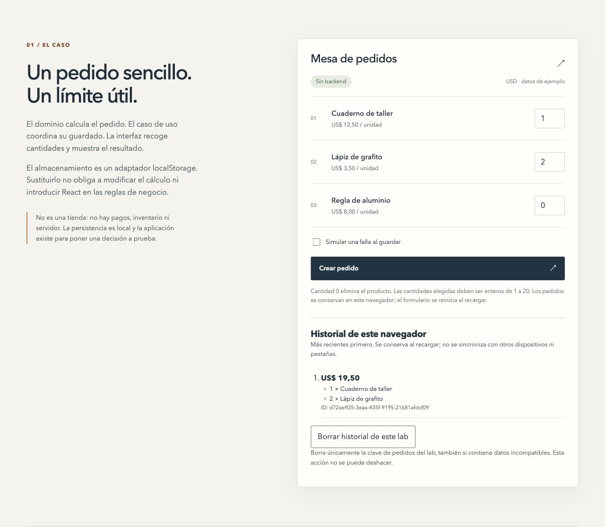
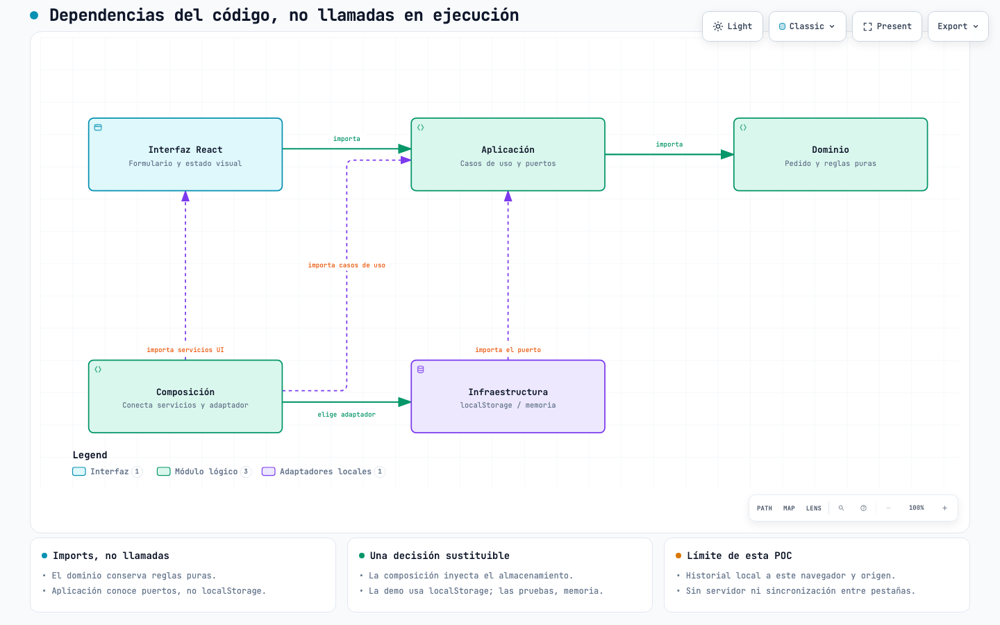

# Dependency Boundaries Lab

Una aplicación de pedidos para comprobar **límites entre dominio, aplicación, interfaz y persistencia** mediante reglas ejecutables.

[**Abrir demo**](https://pabloc43.github.io/lab-dependency-boundaries/) · [CI](https://github.com/Pabloc43/lab-dependency-boundaries/actions) · [Guía técnica](docs/technical-guide.md)



Pedidos conservados en este navegador, fallas reales y simuladas diferenciadas y límites verificables. Sin pagos ni servicios externos.

## Límites, cuatro casos

| Caso                  | Qué comprueba dependency-cruiser                                  | Salida esperada                                          |
| --------------------- | ----------------------------------------------------------------- | -------------------------------------------------------- |
| Aplicación            | Respeta las fronteras elegidas                                    | `0`                                                      |
| Import incorrecto     | El dominio importa una notificación de UI                         | `1` · `no-domain-outward`                                |
| Dependencia circular  | `a.ts` importa `b.ts` y `b.ts` importa `a.ts`                     | `1` · `no-circular`                                      |
| Persistencia acoplada | Aplicación construye el adaptador; la variante inyectada lo evita | Acoplada: `1` · `no-application-outward`; inyectada: `0` |

Los errores son fixtures aislados. `pnpm architecture` pasa cuando coinciden todos los resultados esperados, incluidas las dos variantes de persistencia.

## Ejecutar en local

Requiere **Node.js 24.x** y **pnpm 10.34.9**, fijados en [la configuración del proyecto](package.json).

```sh
git clone https://github.com/Pabloc43/lab-dependency-boundaries.git
cd lab-dependency-boundaries
pnpm install --frozen-lockfile
pnpm check
pnpm dev
```

Abre la dirección que muestra Vite, bajo `/lab-dependency-boundaries/`. El pedido acepta cantidades enteras de **1 a 20**; **0** excluye el producto. Recargar conserva el historial y reinicia el formulario. **Borrar historial de este lab** elimina solo sus pedidos locales, sin tocar otras claves del mismo origen.

Para ejecutar las pruebas de navegador:

```sh
pnpm exec playwright install chromium
pnpm test:e2e
```

La persistencia usa un documento versionado en localStorage, no un backend. Datos incompatibles o permisos bloqueados muestran errores; no se sustituyen silenciosamente por memoria. [Formato y límites](docs/technical-guide.md#persistencia-local).

## El código empieza por lo que hace

```text
src/
├── app/                         # Composición y estructura del sitio
└── features/
    ├── orders/                  # Dominio, casos de uso, adaptadores e interfaz
    └── architecture-lab/        # Guía, evidencia y visores interactivos
```

Cada componente tiene su carpeta con la implementación en `index.tsx`, su CSS Module y los hooks o pruebas exclusivos. Los contratos compartidos viven en el ancestro común más cercano; no hay barrels de reexportación. Las reglas de capas protegen pedidos; los ciclos y los imports no resueltos se comprueban en todo el código productivo.

<a href="https://pabloc43.github.io/lab-dependency-boundaries/diagrams/architecture.html"></a>

Miniatura estática del mapa. [Abrir el diagrama interactivo](https://pabloc43.github.io/lab-dependency-boundaries/diagrams/architecture.html).

## Explorar un fallo sin romper la demo

Selecciona **Import incorrecto**, **Dependencia circular** o **Persistencia acoplada** en la demo. Reproduce los casos con `pnpm architecture`; la [guía técnica](docs/technical-guide.md#ver-una-infracción-directamente) incluye el comando para inspeccionar cada fallo y las pruebas de cobertura de las fronteras.

La evidencia se genera del código durante el build: **no es un analizador online ni un indicador del último CI**. La herramienta verifica imports estáticos, no decide si una arquitectura es adecuada.

Cada ejecución del CI también ofrece **architecture-report**: HTML nativo de dependency-cruiser, JSON y resumen del código productivo, incluso si fallan otros checks. Se descarga desde **Actions → ejecución → Artifacts** (14 días); requiere acceso a GitHub. En local: `pnpm architecture:report`. Los fixtures esperados quedan fuera de ese informe. [Detalle y límites](docs/technical-guide.md#informe-html-del-ci).

## Herramientas utilizadas

Las reglas de dependencias y los ciclos se comprueban con [dependency-cruiser](https://github.com/sverweij/dependency-cruiser). Los diagramas interactivos de arquitectura y CI se generaron con [Archify](https://github.com/tt-a1i/archify).

## Más detalle

[Decisiones, pruebas, fallback, accesibilidad y despliegue](docs/technical-guide.md) · [MIT](LICENSE) · [Licencia y avisos de Archify](public/diagrams/ARCHIFY-NOTICES.md)
